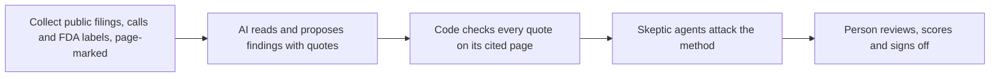

# Deck content (company-neutral)

Draft Sat Oct 17 by the presentation lead. **No company has been picked.** The slides use slots: [COMPANY], [TICKER],
[NEEDLE], [PRODUCT], [RIVALS]. Section "Candidate fills" at the end shows what each slot would hold for the four
companies we deep-read (AMGN, AZN, JNJ, MRK), in alphabetical order. That section is reference only, not a pick.

The structure follows deck/outline.md, one idea per slide. Every number is cited. Method numbers come from
docs/red_team_v2_company_pick.md ("RT2"), docs/how_we_did_it.md, docs/needle_gate2.md, docs/needle_sealed.md and the
four docs/nuggets/*_ai_caught.jsonl files. Other streams still own these pieces:

- Needle: docs/fanout/needle/
- Peer column: docs/fanout/peers/
- Product table: docs/fanout/product/
- Part 2: docs/fanout/part2/

Rubric (AI_Innovation_Competition_Judging_Rubric.pdf): 7 categories, 1 to 4 points each, 28 total. The categories are
Innovation and Creativity, Technical Execution, Use of AI and Responsible Design, Completeness, Design and Usability,
Impact and Presentation. The rubric says "do not give credit for features that were only described or planned," so
every capability claim on a slide points to a screen we can open live (tabs in app/needle_app.py: League table,
Findings, Product fine print, AI caught, Proof).

---

## 1. Title

**Headline:** NEEDLE: AI reads a drugmaker's fine print, code checks every quote against its page

- Aidan Jones (AI build), Parker Kingsbury (finance and business case)
- Advanced track, Pharmaceutical case "The Fine Print"
- Company: [COMPANY]
- One-liner: a buy-side pharma analyst gets a cited, page-checked findings table for one drugmaker in [TBD: timed
  NEEDLE run] instead of [TBD: timed manual read] (PLAN.md; both still to be measured)

Rubric: Presentation. Case: video intro (team, track, case).

## 2. Why [COMPANY] beat the other nine

**Headline:** [One sentence: why [COMPANY]'s findings hold up better than the rest]

Method (same whichever company we pick):
- Code screened all ten shortlist companies; people and an AI miner deep-read four (AMGN, AZN, JNJ, MRK).
- We re-checked all 238 evidence quotes across those four against their pages, and all 238 passed (RT2, "How I tested").
- A red-team agent scored each on six criteria out of 30: needle, surviving rows, product tie, Part 2 fuel, evidence
  quality, distance from the starter thread (RT2 section 8).
- We chose on human-read findings, not on the code's league table (docs/how_we_did_it.md section 5).

Slot: [4-row score table from RT2 section 1, with [COMPANY] highlighted]

Rubric: Innovation, Impact. Case: "explain why it beat the other nine."

## 3. The starter thread, and what it misses

**Headline:** Everyone knows [STARTER THREAD]. What it misses is [NEEDLE in plain words].

- Starter thread, quoted from the case appendix: [STARTER THREAD]
- What it misses: [one line]
- Evidence that it is not discussed: [e.g. call-transcript search hits for the key term]

Rubric: Innovation. Case: restating the starter thread "will not score well."

## 4. Findings table (case column order)

**Headline:** [N] findings hold up. Each one opens to its page and has dollar math.

| # | Finding | Source | Impact (math) | Peer comparison | Confidence |
|---|---|---|---|---|---|
| 1 to 5+ | [from docs/nuggets/[TICKER].md, rows that survive RT2 section 3] | filing + printed page, or speaker + exact quote | revenue, operating income or EPS, math shown | [docs/fanout/peers/] | High / Medium / Low |

Rules the table follows whatever the company:
- A row survives only if every quote verifies, it is not a one-off, it is outside the starter thread, it has a dollar
  effect, it is at least Medium confidence, and it is not waiting on a person (RT2 section 3).
- Every assumed input is labelled "(assumption)" in the math.
- No two rows count the same dollars (RT2 section 9).

Rubric: Completeness, Technical Execution. Case: at least five findings, five columns.

## 5. Sharpest Needle

**Headline:** [NEEDLE in one sentence, with its dollar figure]

- What it is: [one line]
- How much: [pretax $, EPS, year]
- Why it is easy to miss: [evidence, e.g. call mentions]
- How we know it holds: [second source, ideally a counterparty's filing]
- The "priced in?" answer: [one sentence]

Rubric: Innovation, Presentation. Case: "most material and least-discussed."

## 6. Product fine print: [PRODUCT] vs [RIVALS]

**Headline:** [The one label difference that matters]

| Dimension | [PRODUCT] | [RIVAL 1] | [RIVAL 2] | [RIVAL 3] |
|---|---|---|---|---|
| Approved uses | | | | |
| Boxed warnings and safety fine print | | | | |
| Dosing and convenience | | | | |
| Patent and exclusivity timeline | | | | |
| Pricing and gross-to-net exposure | | | | |

- Source: docs/fanout/product/.
- Patent dates come from each 10-K patent table and the Orange or Purple Book. Do not use the code's
  "protection ends" field unchecked: RT2 found it wrong for Keytruda, Enbrel and Darzalex (RT2 section 10).

Rubric: Completeness. Case: five dimensions.

## 7. Where the label shows up in the numbers

**Headline:** [Label difference] shows up as [$ line item]

- Tie to finding #[n]: [one line with $ and page]
- Growth limiter, one sentence: [what actually limits [PRODUCT]'s growth]
- Priced in? [yes or no, and why]

Rubric: Impact. Case: tie the label to a finding; growth limiter; priced-in call.

## 8 to 12. Part 2: Decide

Content comes from docs/fanout/part2/. One slide each, in this order:

| # | Slide | Must contain | Rubric |
|---|---|---|---|
| 8 | The move | One sentence, 24 months, budget or people | Impact |
| 9 | The case for it | Which findings drive it, cost, return, math | Impact, Technical Execution |
| 10 | Two alternatives we rejected | Why each was strong, why we passed | Presentation |
| 11 | What would prove us wrong | Signals in months 6 to 12, threshold, action | Use of AI and Responsible Design, Impact |
| 12 | Why it lands | Doctors, payers, regulators, investors: evidence, what it can and cannot tell us | Impact |

If the move includes anything a doctor or patient would see: FDA-approved uses only, risks as prominent as
benefits, comparisons only with head-to-head evidence, labelled "Student concept, not actual promotional material.",
claims map in appendix A2 (case PDF).

## 13. How it works

**Headline:** The AI reads. The code checks. A person signs off.

| Step | AI or code | Proof |
|---|---|---|
| Collect | Code: SEC EDGAR, XBRL, FDA labels, Orange and Purple Book, CMS | docs/how_we_did_it.md section 1 |
| Read and propose | AI: Claude through agent/llm.py, cached | nugget-miner agent |
| Check the page | Code: `agent.needle.pages.check`, exact or fuzzy match on the cited page | 238 of 238 quotes pass across four companies (RT2) |
| Attack | AI skeptics at three gates | Gate 2 refuted our own first backtest (docs/needle_gate2.md) |
| Sign off | People | Every finding on a slide is human-picked (docs/how_we_did_it.md section 2) |

- Every signal, verdict and prediction is written to a hash-chained audit log, so tampering shows
  (agent/needle/audit.py; docs/how_we_did_it.md).
- Reusable build: `python -m agent.needle.onboard VRTX` points it at a company outside the shortlist with no hand
  edits (agent/needle/onboard.py; docs/red_team_v1.md says it is proven on VRTX).

Rubric: Technical Execution, Use of AI and Responsible Design. Case: reusable build.

## 14. AI caught

**Headline:** The AI was confidently wrong 43 times. The checks caught every one before a slide did.

Counts from the four docs/nuggets/*_ai_caught.jsonl files (one row per catch):

| Company | Catches logged |
|---|---|
| AMGN | 15 |
| JNJ | 11 |
| MRK | 10 |
| AZN | 7 |
| **Total** | **43** |

Plus 9 errors in our own tool, each now guarded by a test (docs/how_we_did_it.md section 4).

Types of error, in plain words (from the rows):
- Quote on the wrong page (most AMGN rows, e.g. "quote is on page 40, not page 39")
- Speaker could not be confirmed near the quote, so a person reviews it (e.g. MRK 4 rows, JNJ several)
- AI added a "fact" from memory that is not in the documents (e.g. a product's technology brand name)
- An older filing was superseded by a newer one (e.g. a court date that moved)
- A "quote" was really an AI-written summary on a transcript website, so it can never be quoted (AMGN)
- A teammate's lead was not supported by any document (JNJ, two rows)

Best example, any company: our code flagged AstraZeneca's receivables rising 23.3% vs revenue 8.6% as a collections
red flag. The footnote showed it was factoring; without it receivables fell 0.8% (AZN 20-F FY2025 p.F-29;
docs/how_we_did_it.md row 9).

Our own biggest error: the first backtest claimed a 59% vs 43% hit rate. Two AI skeptics found the data overlapped
what was already known. The honest version shows no signal predicts hard events (docs/needle_gate2.md).

Chart: horizontal bar chart of catches by error type, text labels on each bar, one neutral color, no legend.
[TBD: count by type across all four files once the "kind" field is filled in AMGN and AZN rows; today only JNJ and MRK
rows carry it.]

Slot: [two [COMPANY] examples: "AI said / page said / what we did"]

Rubric: Use of AI and Responsible Design. Case: "at least one case where the AI was confidently wrong."

Notes: Anything the checker cannot confirm goes to a person ("needs_human") and never reaches a slide on its own.
Findings are flags for review, not buy or sell calls (PLAN.md cut list).

## 15. Limits we state up front

**Headline:** What NEEDLE does not do

- It does not predict stock moves. After the skeptics' fixes, no forensic signal significantly predicts a revenue
  drop or impairment (1,410 firm-quarters, 43 companies, 2012 to 2024; docs/needle_gate2.md).
- What does hold: the revenue forecaster's 80% range covered 79.4% of 1,793 past firm-quarters, and it called J&J's
  Q3 2026 growth blind (+7.3% forecast, range +4.3% to +10.4%, actual +5.9%) (docs/needle_gate2.md).
- Seven Q3 2026 predictions were sealed with a hash before results came out (docs/needle_sealed.md).
- Some inputs are our assumptions; every one is labelled.
- It runs offline on a saved set of documents; no live web search (PLAN.md cut list).
- Call transcripts are not fetched automatically; they are added by hand (agent/needle/onboard.py).

Rubric: Completeness ("limitations are stated clearly and honestly").

---

## Appendix

- A1 Impact math for every finding: the `impact.formula` field from docs/nuggets/[TICKER].jsonl.
- A2 Claims map and A3 campaign concept: only if Part 2 has doctor- or patient-facing material.
- A4 Backtest and calibration: docs/needle_gate2.md tables; sealed hash sha256 c29a6793...e67e65, n = 7
  (docs/needle_sealed.md).

---

## Rubric coverage

| Rubric category (1 to 4 each) | Slides | Live screen that proves it |
|---|---|---|
| Innovation and Creativity | 2, 3, 5 | League table, Findings |
| Technical Execution | 4, 9, 13, A4 | Click a citation, it opens the page; Proof tab |
| Use of AI and Responsible Design | 11, 13, 14 | AI caught tab |
| Completeness | 4, 6, 15 | Product fine print tab |
| Design and Usability | 13 plus the accessibility rules | The five app tabs as the analyst's workflow |
| Impact | 2, 7, 8 to 12 | Part 2 slides |
| Presentation | 1, 5, demo | DEMO_SCRIPT_v2.md |

Weakest today: Design and Usability (no slide shows the analyst's workflow or accessibility) and Impact (time saved
is not measured yet; Part 2 pending). Cheapest fixes: time one manual 10-K read before Sunday 10:30 am; walk the five
tabs as the analyst's day on slide 13.

Accessibility on every slide (deck/outline.md): color-blind-safe palette, text labels on charts, 18 pt minimum body.

---

## Candidate fills (reference only, not a pick)

Everything here is from RT2 and docs/nuggets/<TICKER>.md. Red-team scores are out of 30 (RT2 section 8). RT2
recommends one company, but the team has not decided.

| Slot | AMGN | AZN | JNJ | MRK |
|---|---|---|---|---|
| Red-team score | 20 | 16.5 | 23.5 | 24.5 |
| [NEEDLE] candidate | Enbrel Q2 2026 decline flattered by a 16-point favorable true-up, $97M in one quarter (002) | US gross-to-net give-back, $1,804m (001) | Second-wave US erosion beyond STELARA, $390M a quarter (010) | 2.5% Keytruda royalty to BMS and Ono ends after Dec 31, 2026: about $821M pretax, +$0.28 EPS in 2027 (001) |
| Second source | Amgen's own bridges do not reconcile (weakness) | 2023 ratio about equals 2025 (weakness) | Q3 2026 8-K product schedule | BMS's own 10-K: $588M / 0.75 = $784M vs $792M, within 1% |
| Main red-team risk | Small, third-party transcripts | Base year is an outlier | 001 Genmab needle is the CEO's talking point; use 010 | "Priced in": schedule public since 2017 |
| [PRODUCT] vs [RIVALS] | Enbrel vs Skyrizi, Rinvoq, Humira; or Repatha vs Praluent, Leqvio, Lipfendra | Tagrisso vs Rybrevant + Lazcluze | Darzalex vs Sarclisa; Tremfya vs Skyrizi, Rinvoq, Wezlana | Keytruda vs Opdivo, Imfinzi, Tecentriq |
| Product score (of 5) | 3.5 | 2 | 3.5 | 4 |
| AI caught rows | 15 | 7 | 11 | 10 |

Starter threads (case appendix): Amgen, Enbrel and Repatha lose US exclusivity around 2029; AstraZeneca, cancer
growth, near-term exclusivity losses and US pricing politics; J&J, Stelara biosimilar erosion and Medicare
negotiation; Merck, Keytruda's 2028 patent expiry and Januvia generics.
